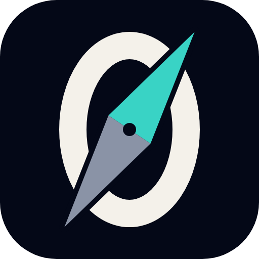

# Zero Trust

Public edition v2.8.3, 18 October 2026.

A Zero Trust study guide and one-page quick references for anyone leading or learning Zero Trust: a shared core, then DoW, federal civilian and private-sector tracks.

**Open it:** https://kensden.github.io/lensatic/guides/zero-trust/

## What's inside

| | |
|---|---|
| [Web page](index.html) | The study guide, the three Quick References and the grouped Sources list on one phone-first page, in light and dark themes, with a track switcher at the top. |
| [Study guide (PDF)](20261018_ZT_Study_Guide_v2.8.3.pdf) | The printable guide, core and all three tracks: US Letter, 26 pages, with page numbers. |
| [Quick Reference: DoW (PDF)](20261018_ZT_Quick_Reference_DoW_v2.8.3.pdf) | The DoW job aid on one US Letter page. |
| [Quick Reference: Federal civilian (PDF)](20261018_ZT_Quick_Reference_Federal_Civilian_v2.8.3.pdf) | The federal civilian job aid on one US Letter page. |
| [Quick Reference: Private sector (PDF)](20261018_ZT_Quick_Reference_Private_Sector_v2.8.3.pdf) | The private-sector job aid on one US Letter page. |
| [Verification record](VERIFICATION.md) | What was checked, against which primary source and page, and what was corrected, for v1.0, v2.0 and v2.2. |
| [License](LICENSE) | The all-rights-reserved notice. |

## Go deeper

[Zero Trust in the Age of AI](https://notebooklm.link.google/jaUFZqYbnxIe) is a companion NotebookLM notebook I built on this guide's sources, the 2025 to 2026 guidance on AI agents and recorded talks, including transcripts of five government talks from the 2026 DoW Zero Trust Virtual Learning Exchange. Anyone with the link and a Google account can read it, ask it questions, and play its audio overview, mind map, flashcards and quiz; start with its "START HERE" note.

## How it was built

I built this with Claude and Claude Code. Claude helped me scrub, research and verify it, and Claude Code built the page and PDFs.

I reviewed every change, and I own the result, mistakes included.

## License

Zero Trust is copyright 2026 Ken Connell, all rights reserved ([LICENSE](LICENSE)). The repository is published so the work can be read, reviewed and used for personal study. No license is granted to copy, modify, distribute or otherwise use its text or files, in whole or in part, except as the law allows without a license or with Ken Connell's prior written permission. To ask about reuse, open an issue at https://github.com/KensDen/lensatic/issues.

GitHub's Terms of Service (section D.5) let other GitHub users view and fork a public repository on GitHub, as GitHub's features allow; that is not permission to use the work anywhere else.

Versions 1.0 (27 September 2026) and 2.0 (30 September 2026) were released under the Creative Commons Attribution-NonCommercial-ShareAlike 4.0 International license (CC BY-NC-SA 4.0). That grant still applies to copies of those versions. It does not apply to anything added or changed since. On 30 September 2026 the history of the guide's original repository was replaced with a single fresh commit holding version 2.0, so version 1.0 is no longer part of its history.

Third-party material keeps its own terms. Third-party names are trademarks of their respective owners. US government sources are public works, cited and linked here, not reproduced. The page and PDFs embed IBM Plex Sans and IBM Plex Mono (Copyright IBM Corp.) under the SIL Open Font License 1.1, whose full text is in the page's stylesheet.

A personal project: views are my own and do not represent any employer or government organization.

Built with Claude and Claude Code, reviewed by a human who owns the mistakes.
